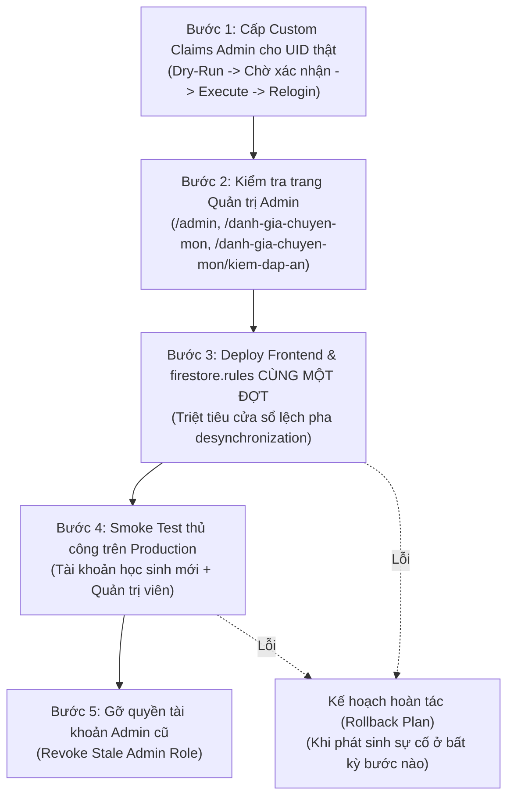

# 🛠️ NỘI BỘ — QUY TRÌNH TRIỂN KHAI VÀ CHUYỂN ĐỔI BẢO MẬT (DEPLOY RUNBOOK)
> **LƯU Ý**: Tài liệu hướng dẫn vận hành kỹ thuật nội bộ dành cho đội ngũ phát triển và DevOps của STEM HUB. **KHÔNG nộp tài liệu này trong hồ sơ chính thức gửi BGK.**

---

## 🎯 1. NGUYÊN TẮC VÀ THỨ TỰ THỰC HIỆN BẮT BUỘC

Quy trình triển khai phiên bản bảo mật mới tuân thủ nghiêm ngặt thứ tự 5 bước tuyến tính:



---

## 📋 2. CHI TIẾT 5 BƯỚC TRIỂN KHAI

### Bước 1: Cấp Custom Claims Quản trị viên cho UID thật

> [!IMPORTANT]
> **Quy tắc an toàn tuyệt đối**:
> 1. Luôn chạy ở chế độ **Dry-Run (chỉ đọc)** trước để kiểm tra thông tin tài khoản Auth.
> 2. **Chờ xác nhận** từ chủ tài khoản mới được chạy cờ `--execute`.

1. **Chạy kiểm tra thử nghiệm (Dry-Run)**:
   ```powershell
   # Kiểm tra tài khoản admin chính
   node scripts/grant_admin_role.cjs --uid=7jmOy8lyr1hsmrflTMvdoXOJmew1

   # Kiểm tra tài khoản admin dự phòng (nếu có)
   node scripts/grant_admin_role.cjs --uid=T5O0uVvKPpeS82oGSp7fxr0pGVf1
   ```
   *Kết quả Dry-Run:* In UID che (`7jmO***mew1`), email che, trạng thái Auth và claims hiện tại. Không thay đổi dữ liệu.

2. **Chờ người dùng xác nhận**:
   Chỉ khi người dùng xác nhận đúng tài khoản cần nâng quyền, mới tiến hành bước 3.

3. **Thực thi cấp quyền chính thức**:
   ```powershell
   node scripts/grant_admin_role.cjs --uid=7jmOy8lyr1hsmrflTMvdoXOJmew1 --execute
   node scripts/grant_admin_role.cjs --uid=T5O0uVvKPpeS82oGSp7fxr0pGVf1 --execute
   ```

4. **Làm mới phiên đăng nhập (Bắt buộc)**:
   - Sau khi cấp claim, Token cũ trên trình duyệt chưa có claim mới.
   - Quản trị viên **Đăng xuất (Sign Out)** và **Đăng nhập lại (Sign In)** trên trang web.
   - Kiểm tra Token tại Console trình duyệt:
     ```javascript
     const token = await firebase.auth().currentUser.getIdTokenResult(true);
     console.log('Admin claim:', token.claims.admin); // Phải in ra: true
     ```

---

### Bước 2: Kiểm tra trang Quản trị Admin (Pre-deploy Verification)

Trước khi tiến hành deploy lên Production, quản trị viên kiểm tra trực tiếp trên môi trường chạy thử:

1. Truy cập `/admin`: Xác nhận bảng điều khiển tổng quan tải dữ liệu bình thường, hiển thị đầy đủ menu quản trị.
2. Truy cập `/danh-gia-chuyen-mon`: Xác nhận giao diện thẩm định câu hỏi trợ lý AI tải danh sách mẫu, không bị lỗi 401/403 hay màn hình đen.
3. Truy cập `/danh-gia-chuyen-mon/kiem-dap-an`: Xác nhận giao diện kiểm tra đáp án Toán (hỗ trợ cả Dark mode và Light mode) hiển thị đầy đủ bảng đối chiếu nguồn chính thức.
4. Kiểm tra gọi API quản trị nội bộ:
   ```powershell
   node tests/api_admin_security.test.mjs
   # Kết quả: 4/4 PASS
   ```

---

### Bước 3: Deploy Frontend và firestore.rules CÙNG MỘT ĐỢT

> [!WARNING]
> **Rủi ro cửa sổ lệch pha (Desynchronization Window)**:
> - Nếu deploy `firestore.rules` mới trước Frontend: Client cũ vẫn gửi trường `role: 'student'` khi đăng ký sẽ bị rules mới chặn (do rules mới chặn trường `role`).
> - Nếu deploy Frontend trước rules mới: Có thể phát sinh bất đồng bộ quyền hạn giữa mã client và luật DB.
> **Giải pháp**: Tiến hành deploy rules và đẩy code Frontend song song trong cùng một đợt release.

1. **Kiểm tra cú pháp Rules và kiểm thử an toàn**:
   ```powershell
   node tests/firestore.rules.test.js
   ```

2. **Deploy Rules Firestore**:
   ```powershell
   firebase deploy --only firestore:rules
   ```

3. **Deploy Frontend Next.js lên Vercel Production**:
   ```powershell
   # Merge nhánh làm việc feat/ablation-real vào main
   git checkout main
   git merge feat/ablation-real
   git push origin main
   ```
   *(Vercel sẽ tự động kích hoạt tiến trình Build & Deploy Production).*

---

### Bước 4: Smoke Test thủ công trên Production

Sau khi Vercel và Firebase hoàn tất việc deploy, thực hiện kiểm thử khói thủ công trên domain chính thức `https://ai.stem-hub.top`:

1. **Kiểm thử Tài khoản Học sinh mới**:
   - Mở cửa sổ ẩn danh (Incognito Window).
   - Truy cập `https://ai.stem-hub.top`.
   - Bấm "Đăng ký" tài khoản mới với email thử nghiệm.
   - Kiểm tra: Đăng ký thành công, điều hướng vào trang học tập bình thường.
   - Mở Firebase Console -> Firestore `users/{uid}`: Xác nhận document tạo mới **KHÔNG có trường `role` hay `reviewerType`** (chống leo thang quyền).

2. **Kiểm thử Tài khoản Quản trị viên**:
   - Đăng nhập bằng tài khoản Admin (`7jmO...` hoặc `T5O0...`).
   - Truy cập `https://ai.stem-hub.top/danh-gia-chuyen-mon`.
   - Chuyển đổi giữa Giao diện Tối (Dark) và Giao diện Sáng (Light): Chữ và bảng biểu phải đọc rõ, độ tương phản đạt chuẩn.
   - Thử gửi 1 đánh giá mẫu: Xác nhận lưu thành công vào Firestore `expert_reviews`.

3. **Kiểm thử Zero Exposure AI Gateway**:
   - Mở khung trò chuyện trợ lý AI, đặt 1 câu hỏi STEM ngắn.
   - Mở DevTools Network tab: Xác nhận yêu cầu chỉ gửi về `/api/chat` nội bộ, **hoàn toàn không có URL lộ `generativelanguage.googleapis.com` kèm API key trên client**.

---

### Bước 5: Gỡ quyền tài khoản Admin cũ (Stale Admin Revocation)

Sau khi tài khoản Admin mới đã hoạt động ổn định trên Production, tiến hành thu hồi quyền của các tài khoản quản trị cũ (tài khoản dev/test thử nghiệm trước đây):

1. **Chạy kiểm tra danh sách tài khoản cần gỡ (Dry-Run)**:
   ```powershell
   node scripts/revoke_stale_admin_role.cjs
   ```
   *Script sẽ liệt kê các tài khoản admin cũ cần hạ quyền về `student`.*

2. **Thực thi thu hồi quyền**:
   ```powershell
   node scripts/revoke_stale_admin_role.cjs --execute
   ```
   *Script ghi log bất biến vào collection `admin_logs` để phục vụ hậu kiểm.*

---

## ↩️ 3. KẾ HOẠCH HOÀN TÁC (ROLLBACK PLAN)

Nếu xảy ra sự cố nghiêm trọng ở Bước 3 hoặc Bước 4, lập tức áp dụng quy trình hoàn tác theo từng tầng:

### 3.1. Hoàn tác Firestore Rules (Thời gian xử lý: < 1 phút)
- **Cách 1 (Nhanh nhất)**: Truy cập **Firebase Console** $\rightarrow$ **Firestore Database** $\rightarrow$ Tab **Rules** $\rightarrow$ Bấm **Release history** $\rightarrow$ Chọn bản Rules trước đó và bấm **Rollback**.
- **Cách 2 (CLI)**:
  ```powershell
  git checkout HEAD~1 -- firestore.rules
  firebase deploy --only firestore:rules
  ```

### 3.2. Hoàn tác Frontend Vercel (Thời gian xử lý: < 30 giây)
- Truy cập **Vercel Dashboard** $\rightarrow$ Chọn dự án `stem-hub` $\rightarrow$ Tab **Deployments**.
- Tìm deployment ổn định trước đó (Production trước khi merge).
- Bấm vào biểu tượng 3 chấm $\rightarrow$ Chọn **Instant Rollback**.
- Domain `https://ai.stem-hub.top` sẽ lập tức chuyển hướng về bản build cũ an toàn.

### 3.3. Hoàn tác Claims Quản trị viên
- Nếu tài khoản admin gặp sự cố token hoặc cần cấp lại khẩn cấp:
  ```powershell
  node scripts/grant_admin_role.cjs --uid=<UID_CAN_CAP_LAI> --execute
  ```

---

## 🔑 4. DANH MỤC BIẾN MÔI TRƯỜNG TRÊN PRODUCTION (VERCEL)

| Tên biến | Kiểu (Type) trên Vercel | Mục đích | Nơi sử dụng |
|---|---|---|---|
| `GEMINI_API_KEY` | **Secret** | Khóa gọi Gemini AI (Single/Round-robin) | Backend Next.js Gateway (`geminiCaller.js`) |
| `ABLATION_GEMINI_API_KEY` | **Secret** (Tùy chọn) | Khóa duy nhất dùng riêng cho thí nghiệm Ablation | Runner (`run_ablation_real.mjs`) |
| `FIREBASE_PROJECT_ID` | **Secret** | Mã project Firebase `cuoc-thi-ai-e2044` | Firebase Admin SDK (`firebaseAdmin.js`) |
| `FIREBASE_CLIENT_EMAIL` | **Secret** | Service Account Email | Firebase Admin SDK (`firebaseAdmin.js`) |
| `FIREBASE_PRIVATE_KEY` | **Secret** | Private Key giải mã token JWT | Firebase Admin SDK (`firebaseAdmin.js`) |
| `ADMIN_UIDS` | **Secret** | Danh sách UID quản trị viên backend | Server API Routes (`/api/learned-knowledge`,...) |
| `NEXT_PUBLIC_ADMIN_UIDS` | **Config** | Danh sách UID hiển thị nút Admin | Giao diện Client (`layout.js`, `lien-he`) |
| `CRON_SECRET` | **Secret** | Khóa bảo vệ API Cron Job dọn dẹp log | API dọn dẹp hệ thống |
| `ADMIN_SECRET_KEY` | **Secret** | Chuỗi token ngẫu nhiên bảo mật nội bộ | Chữ ký API nội bộ |
